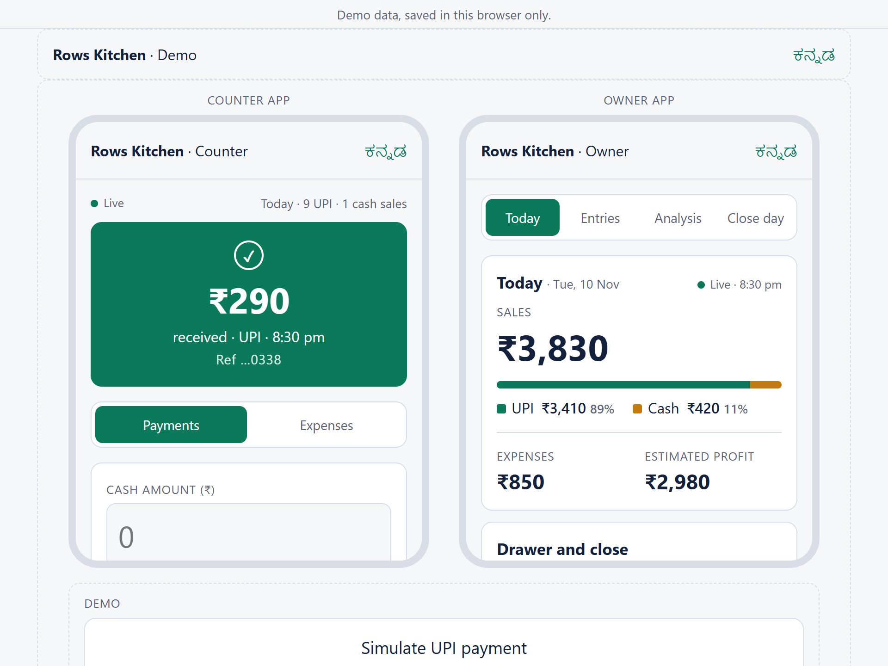
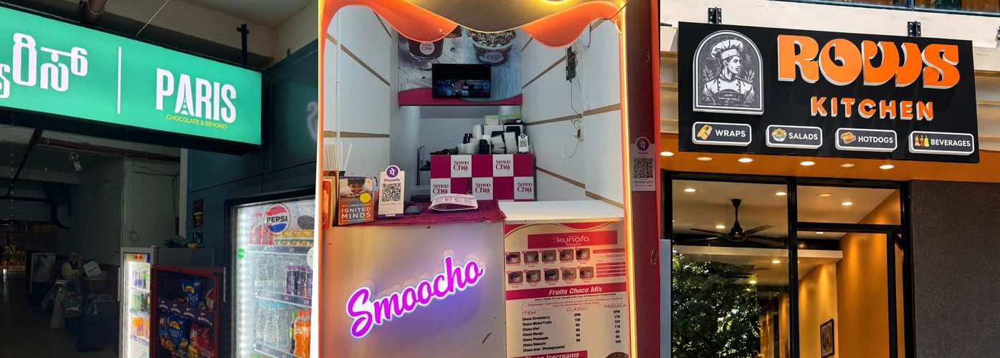
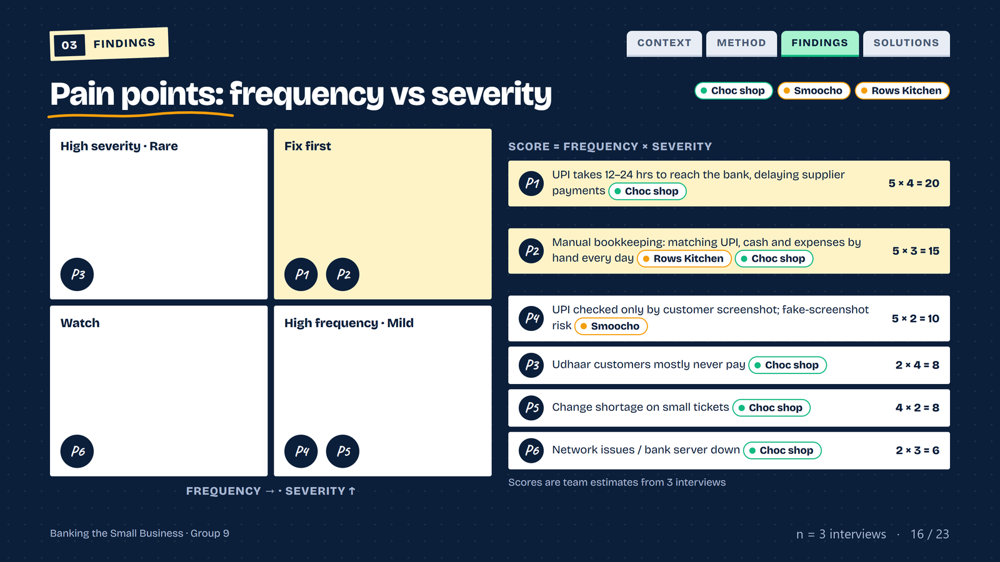

# Case study: Lekka

*Lekka (ಲೆಕ್ಕ) is Kannada for "the accounts".* A two-screen money book for a small restaurant: the counter sees every UPI payment arrive, and the owner sees the day add up and closes it in a minute.

| | |
|---|---|
| **Context** | Banking Technology Lab, Group 9 · class prototype, November 2026 |
| **Shop** | Rows Kitchen, Mangaluru (owner interviews; all data in the app is fake) |
| **My role** | Group lead. Conducted one of the shop-owner interviews and built the prototype. |
| **Stack** | React 19, TypeScript, Vite, Supabase (Postgres + Realtime), Vitest |
| **Try it** | `npm install`, `npm run dev`, open `http://localhost:5173/?mock#/demo` |

*Demo view: a UPI payment arrives at the counter (left) as the owner's totals update (right).*

## The research

The app came out of our group's thought paper for the course, *Banking the Small Business*. We interviewed people at three small businesses in Manipal and Mangaluru using a 15-minute guide: a chocolate shop, a dessert-cup kiosk (Smoocho) and a wraps outlet (Rows Kitchen). We asked which banks and apps they use, how money comes in and goes out, and what hurts.

*The three shops we visited: Choc shop, Smoocho and Rows Kitchen.*

| Finding | Result |
|---|---|
| UPI share of payments | 77–94% at all three shops; cash 6–23%; cards almost unused |
| Loans or overdrafts | 0 of 3. Nobody needed credit |
| How the counter confirms a UPI payment | Soundbox at Rows Kitchen (strong); a customer's screenshot at Smoocho (weak: a fake can't be spotted) |
| Top pain points (frequency × severity, out of 25) | UPI settlement delay 20, manual bookkeeping 15 |
| What Rows Kitchen asked for | Under ₹100 a month, no hidden charges, a simple screen, Kannada helpful |

*Pain points scored by frequency × severity, from the group's presentation. Scores are team estimates from three interviews.*

The short version: collecting payments is solved; knowing what happened to the money afterwards is not.

## The problem

The top-scoring pain, settlement delay, needs a bank to change. Bookkeeping and payment checks can be fixed with an app today, so the prototype takes those:

1. **Night-time matching.** UPI, cash and expenses are written down by hand and matched against the bank app after closing. At Rows Kitchen this was the owners' most time-consuming task, almost every day.
2. **The counter can't see UPI arrive.** At Smoocho the payment lands in the owner's account, so the worker has to trust a customer's screenshot.

There was a third constraint the owners were clear about: counter staff should not see the shop's profit.

## What I built

One web app, two screens, one shared database.

**Counter** (worker)
- Each UPI payment appears as a large banner with the amount, time and last 4 digits of the reference, plus a chime, so the worker can match it to the customer's phone without a screenshot.
- A cash sale takes two taps. Expenses are entered where they're paid: amount, category, payee, cash from the drawer or UPI.
- Shows counts ("7 UPI · 1 cash sale"), never rupee totals or profit.

**Owner**
- **Today:** sales with the UPI/cash split, expenses, estimated profit, and the cash that should be in the drawer right now.
- **Entries:** every entry with its source. A wrong one is voided with a reason; it stays listed, struck through, and drops out of the totals.
- **Analysis:** seven days of sales against expenses, busy hours, and plain-sentence insights ("Busiest hour: 7 pm–8 pm").
- **Close the day:** enter the cash counted and the bank app's UPI total. The app shows expected against actual and names each gap ("Cash short ₹150"). The thought paper listed this as proposed; it's now built.

**Demo view:** both screens side by side in phone frames, so the sync is visible on one projector.

## Decisions and why

| Decision | Why |
|---|---|
| Money is stored as whole paise (integers) | Floating-point rupees drift; a reconciliation that's off by a paisa is worse than none. |
| A "day" is the calendar day in `Asia/Kolkata`, computed in one tested function | A UTC day boundary would put an 11:59 pm sale and a 12:01 am sale in the wrong days for an Indian shop. |
| Entries are never deleted, only voided with a reason | The owner needs to see what was changed and why. The database policy enforces it: the public key can add and void, not delete or edit an amount. |
| Expected drawer cash = cash sales − cash expenses *entered at the counter* | Owners pay cash from money they withdraw themselves, so their expenses never leave the drawer. Found by walking through a real day with the numbers. |
| A close is checked only against entries made before it | Sales after the count would otherwise show as a false shortage; the app says how many entries came in later instead. |
| Re-query the whole day on every change, instead of patching state | At about 30 entries a day it's cheap, and it can't get out of step. |
| No router, i18n or UI libraries | Two hash routes, two JSON dictionaries and plain CSS cover it. Three runtime dependencies in total. |
| Mock mode in the browser, same interface as the database | The app could be built and shown before the backend existed, and the demo survives bad classroom Wi-Fi. |
| A "Start shift" tap before the counter goes live | Browsers block sound until the user interacts; one honest tap unlocks the chime. |

## How I know it works

- **17 unit tests** on the money logic: totals with voided entries, the India-time day boundary, reconciliation (match, short, over, no cash), rupee formatting in Indian grouping, and that every English string has a Kannada one with the same placeholders.
- **Live sync measured:** a simulated UPI payment reached the counter in under 3 seconds over Supabase Realtime, on a plain-`http` network address as a phone would open it (checked 3 Nov 2026).
- **A 7-step demo script** doubles as the acceptance test: UPI arrives, cash sale, supplier payment, void, close with a ₹150 shortage, language switch, tests and build.

## What it is not

This is a class prototype, and I'd rather say so than have it found out.

- **UPI payments are simulated.** A button stands in for a customer paying. Capturing real payments (bank SMS, a payment provider's webhook) is the hard part of the real product and isn't built.
- **There is no sign-in.** The counter can't see profit only because its screen doesn't show it.
- **The Kannada is machine-translated** and needs a native reader.
- **It hasn't been used in a shop.** The claims above are about the software, not about time saved for an owner.
- **The research is small.** Three interviews, two of them with staff rather than owners, and the pain-point scores are the team's own estimates.

## What I'd do next

1. Sign-in with roles, so "the counter can't see profit" is enforced by the database, not the screen.
2. Real UPI capture, starting with whichever source the shop already has (a soundbox provider's API or bank SMS).
3. A week's pilot at one shop, measuring minutes spent on the nightly match before and after.
