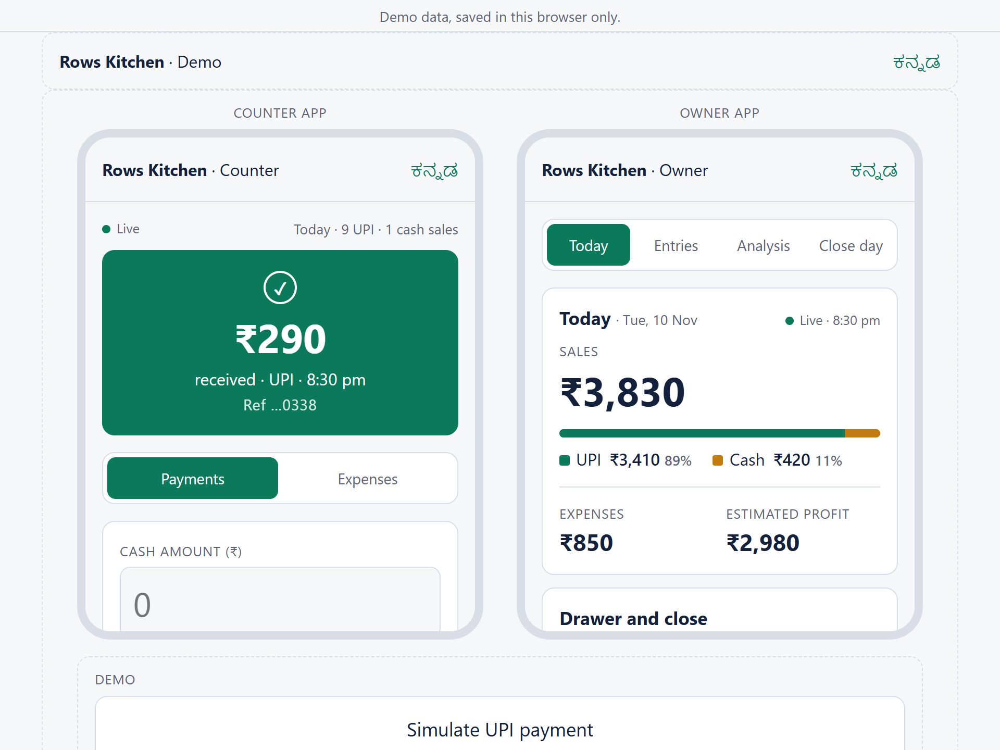
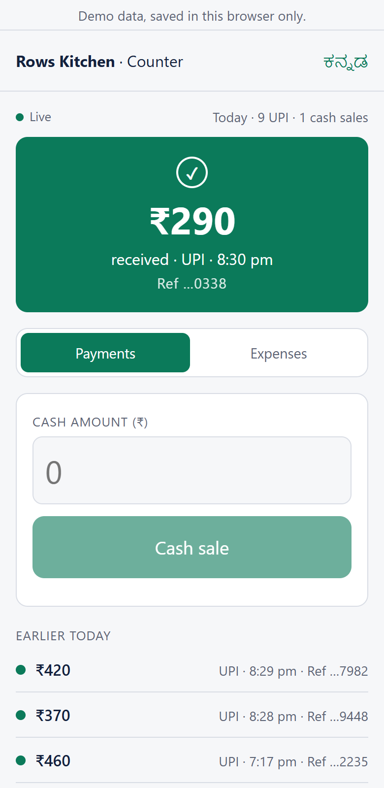
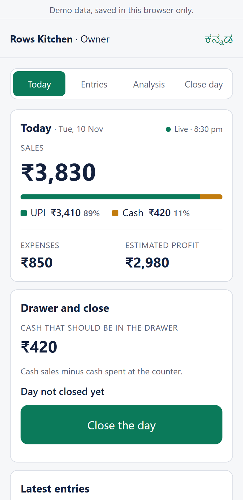
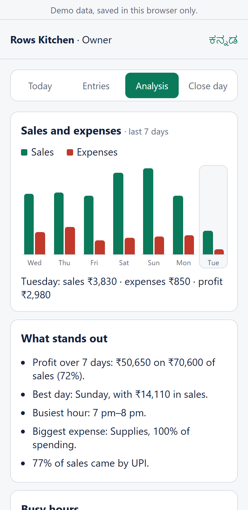
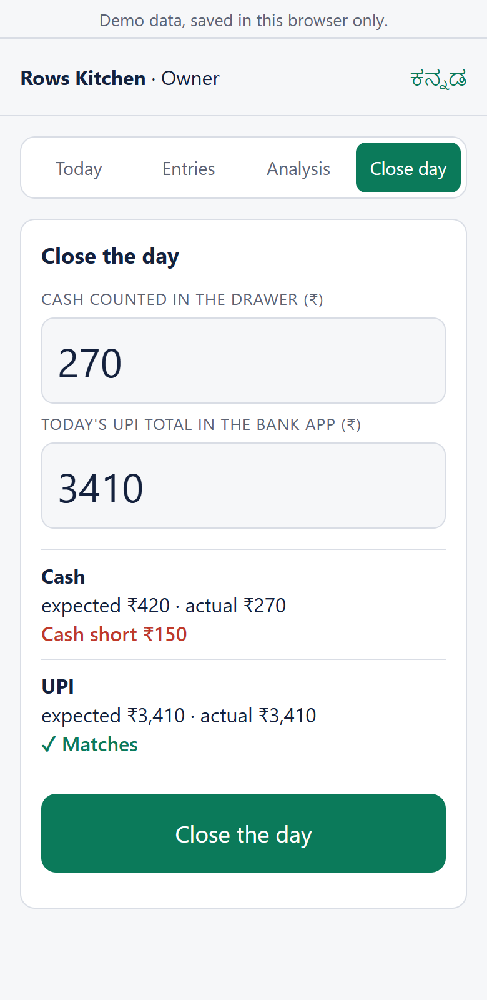

# Lekka

*Lekka (ಲೆಕ್ಕ) is Kannada for "the accounts".* A two-screen money book for a small restaurant.

A class demo for Banking Technology Lab, Group 9. It's one web app with two screens for **Rows Kitchen**, Mangaluru:

- **Counter app** (`#/counter`): for the worker at the counter. It shows each UPI payment as it arrives, with a chime, and records cash sales, and has an **Expenses** tab for everything the shop pays out. It never shows profit or sales totals.
- **Owner app** (`#/owner`): for Ashwin and Adrien. It has today's sales, UPI, cash, expenses and estimated profit; a list of today's entries where wrong ones can be voided, plus a **Monthly bill** entry for rent and salary; **Analysis** (last 7 days, busy hours, plain-sentence insights); and **Close the day**, which checks the drawer cash and the bank's UPI total against what was recorded.

- **Demo view** (`#/demo`): both apps side by side in phone frames, with the **Simulate UPI payment** button underneath, so the whole story fits on one projector screen. Tap **Start shift** in the counter frame first to turn on the chime.

Both screens share one Supabase database, so whatever happens on one shows on the other within a few seconds. The full requirements are in [SPEC.md](SPEC.md), the build plan is in [tasks/plan.md](tasks/plan.md), and the write-up is in [CASE_STUDY.md](CASE_STUDY.md).



| Counter | Owner · Today | Owner · Analysis | Owner · Close day |
|---|---|---|---|
|  |  |  |  |

Add `?mock` before the `#` (for example `http://localhost:5173/?mock#/demo`) to run on fresh in-browser sample data even when Supabase is set up. Use it when the database hasn't been re-seeded or there's no network.

## What is simulated (say this in the demo)

- **UPI payments are simulated.** The owner app's **Simulate UPI payment** button stands in for a customer paying by UPI. Capturing real payments (for example from bank SMS) is not built.
- **There is no sign-in.** Counter staff can't see profit only because the counter screen doesn't show it. Anyone with the link can open the owner screen. That's fine for fake data, not for real money.
- **The Kannada is machine-translated** ([src/i18n/kn.json](src/i18n/kn.json)) and needs checking by someone who reads Kannada.
- **Expected drawer cash** is cash sales minus cash expenses entered at the counter. Owners pay cash from money they withdraw themselves, so their cash expenses don't come out of the drawer. There's no opening float.

## Run it

You need Node 20 or later.

```bash
npm install
```

```bash
npm run dev -- --host
```

- **Without `.env.local`**, the app runs on mock data kept in this browser only. Tabs in the same browser stay in sync, but separate devices don't.
- **With Supabase**, copy `.env.example` to `.env.local` and fill in the project URL and the **publishable** key, from Supabase → Project Settings → API Keys. Never use the secret key: anything in the app is sent to every browser that opens it.

Tests and production build:

```bash
npm test
```

```bash
npm run build
```

## Set up Supabase (once)

In the project's **SQL Editor**, run these in order:

1. [supabase/schema.sql](supabase/schema.sql) creates the tables, turns on live updates, and only lets the public key read, add and void entries. It can't delete or edit amounts.
2. [supabase/seed.sql](supabase/seed.sql) adds a week of Rows-like sample data ending today.

[supabase/fix-permissions.sql](supabase/fix-permissions.sql) is only for a database created with an early version of `schema.sql`.

**Before each demo, run `seed.sql` again.** It wipes all entries and day closes, and makes fresh data for the day of the demo, with "today" covering the last 3 hours.

## Demo setup: owner on the phone, counter on the laptop

The laptop serves the app, so there's no deployment.

1. On the laptop, run `npm run dev -- --host`. Vite prints a `Network` address such as `http://192.168.29.32:5173`.
2. Laptop: open `http://localhost:5173/#/counter` and tap **Start shift**. You should hear a chime.
3. Phone: open `http://<Network address>/#/owner`.

If the phone can't load the page, either Windows Firewall is blocking Node (allow it on private networks), or the Wi-Fi isolates devices from each other. To get round the second, turn on the phone's hotspot and connect the laptop to it, then use the new `Network` address.

The address can change on a different network, so read it from Vite's output each time. On the projector, zoom the laptop browser in (Ctrl +), because the counter is laid out for a phone. Each device remembers its own language.

## Demo script

1. **UPI arrives at the counter.** On the phone, press **Simulate UPI payment**. Within about 3 seconds the laptop chimes and shows "₹___ received · UPI", and the owner's UPI and Sales rise by the same amount.
2. **Cash sale at the counter.** On the laptop, type `200` and press **Cash sale**. The owner's Cash goes up by ₹200.
3. **Supplier payment.** On the laptop, go to the counter's **Expenses** tab, enter ₹1,200, Supplies, "Vegetable vendor", UPI, and save. Expenses and Estimated profit update. (Today only covers a few hours, so ₹1,200 may show a loss in red. Use ₹500 if you'd rather not.)
4. **Fix a mistake.** On the phone, go to **Entries**, tap the ₹200 cash sale, give a reason and press **Void entry**. It stays listed, struck through, and the totals drop by ₹200.
5. **Close the day.** On the phone, go to **Close day** and enter cash ₹150 less than expected, plus the UPI total. It shows "Cash short ₹150". Save.
6. **Kannada.** Tap **ಕನ್ನಡ** in the header on either device.
7. Before the class: `npm test` passes, `npm run build` succeeds, and the phone loads the owner app from the laptop.

## Project layout

```
supabase/          schema, sample data, one-off permission fix
src/main.tsx       picks the counter or owner screen from the URL; language toggle
src/counter/       counter screen: payments, cash entry, expenses
src/owner/         Today, Entries, Analysis, Close day
src/lib/summary.ts money logic (totals, India-time day, close-the-day check) — unit-tested
src/lib/db.ts      Supabase calls; falls back to src/lib/mockDb.ts without .env.local
src/i18n/          English and Kannada text
```
